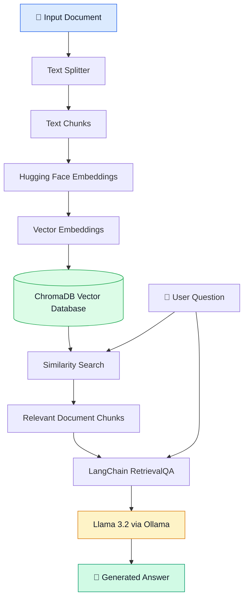

# 🤖 Local RAG System using Llama 3.2, Ollama, LangChain & ChromaDB


A **Retrieval-Augmented Generation (RAG)** application built using Llama 3.2, Ollama, LangChain, Hugging Face Embeddings, and ChromaDB.

This project allows users to ask questions about custom documents and receive relevant, context-aware answers using a locally running Large Language Model (LLM).

---

## 📌 Project Overview

Retrieval-Augmented Generation (RAG) combines information retrieval with generative AI.

Instead of relying only on the knowledge stored in an LLM, RAG retrieves relevant information from a custom knowledge base and provides that information to the LLM to generate more relevant responses.

This project implements a complete RAG pipeline using locally executed Llama 3.2.

### 🎯 Project Objectives

- Understand the working principles of RAG.
- Convert documents into smaller text chunks.
- Generate embeddings using Hugging Face.
- Store embeddings in ChromaDB.
- Retrieve relevant documents using similarity search.
- Generate answers using Llama 3.2 through Ollama.
- Build a locally running question-answering system.

---

## 🏗️ System Architecture

The following diagram illustrates the complete RAG architecture.



### Architecture Explanation

1. **Document Loading:** Loads the input document containing information.
2. **Text Splitting:** Divides the document into smaller chunks.
3. **Embedding Generation:** Hugging Face converts text chunks into numerical vectors.
4. **Vector Storage:** ChromaDB stores the generated embeddings.
5. **User Query:** The user submits a question.
6. **Similarity Search:** ChromaDB retrieves the most relevant document chunks.
7. **RetrievalQA:** LangChain passes the retrieved context to the LLM.
8. **Answer Generation:** Llama 3.2 generates the final response using retrieved information.

---

## 🛠️ Technologies Used

| Technology | Purpose |
|---|---|
| Python 3.14 | Programming language |
| LangChain | RAG framework |
| Llama 3.2 | Large Language Model |
| Ollama | Local LLM execution |
| Hugging Face | Text embeddings |
| all-MiniLM-L6-v2 | Embedding model |
| ChromaDB | Vector database |
| Sentence Transformers | Embedding generation |

---

## 📂 Project Structure

```text
RAG/
│
├── main.py
│
├── chroma_db/
│   └── Vector database files
│
├── README.md
│
├── requirements.txt
│
└── .gitignore
```

---

## ⚙️ Installation and Setup

### 1. Clone the Repository

```bash
git clone https://github.com/bibekpandey0521/RAG.git
```

Navigate to the project directory:

```bash
cd RAG
```

### 2. Create a Virtual Environment

```bash
python -m venv venv
```

Activate the environment on Windows:

```bash
venv\Scripts\activate
```

### 3. Install Required Dependencies

```bash
pip install -U langchain langchain-classic langchain-text-splitters langchain-huggingface langchain-chroma langchain-ollama sentence-transformers chromadb
```

### 4. Install Ollama

Download and install Ollama:

https://ollama.com/download

### 5. Download Llama 3.2

Run the following command:

```bash
ollama pull llama3.2
```

Check the installed model:

```bash
ollama list
```

Expected model:

```text
NAME
llama3.2:latest
```

### 6. Run the Project

Execute the Python application:

```bash
python main.py
```

The application will:

- Load the document.
- Split the document into chunks.
- Generate embeddings.
- Store vectors in ChromaDB.
- Retrieve relevant information.
- Generate answers using Llama 3.2.

---

## 🧠 Models Used

### 1. Llama 3.2

Llama 3.2 is used as the Large Language Model (LLM).

**Purpose:**
- Understand user questions.
- Process retrieved document context.
- Generate natural language answers.
- Run locally using Ollama.

Model:

```text
llama3.2:latest
```

### 2. Hugging Face Embedding Model

Model:

```text
sentence-transformers/all-MiniLM-L6-v2
```

**Purpose:**
- Convert text into numerical vector representations.
- Identify semantically similar documents.
- Support efficient similarity searching.

---

## 🔄 RAG Workflow

The application follows two major stages.

### Stage 1: Document Indexing

1. Load the document.
2. Split the document into smaller chunks.
3. Generate embeddings for each chunk.
4. Store embeddings in ChromaDB.

### Stage 2: Retrieval and Generation

1. Accept a user question.
2. Search for relevant document chunks.
3. Retrieve the most relevant context.
4. Pass the context to Llama 3.2.
5. Generate the final answer.

---

## 💬 Example Questions

The RAG system can answer questions such as:

1. What is reinforcement learning and how does it work?
2. What are the main applications of computer vision?
3. How is NLP used in real-world applications?
4. What is Artificial Intelligence?
5. How does a machine learning agent learn?

### Example Output

**Question:**

What is reinforcement learning and how does it work?

**Answer:**

Reinforcement Learning is a type of machine learning in which an agent learns by interacting with its environment and receiving rewards or penalties. It improves its decisions through experience and is commonly used in robotics, gaming, and autonomous systems.

---

## ✨ Key Features

- Local LLM execution using Ollama.
- Document-based question answering.
- Semantic search using vector embeddings.
- Persistent vector storage with ChromaDB.
- Context-aware answer generation.
- Hugging Face embedding integration.
- No OpenAI or Anthropic API key required.
- Retrieval of relevant source documents.

---

## 🚀 Future Improvements

- Support PDF and DOCX document uploads.
- Build an interactive chatbot interface using Streamlit.
- Support multiple documents.
- Add conversation memory.
- Implement document citation and source tracking.
- Improve retrieval using hybrid search.
- Build a web-based RAG chatbot.

---

## 🔐 Privacy

This project uses a locally running Llama model through Ollama.

Documents and questions are processed locally by the application, while the Hugging Face embedding model may need an initial internet connection to download its model files.

No Anthropic or OpenAI API key is required.

---

## 👨‍💻 Author

**Your Name**

GitHub: https://github.com/bibekpandey0521

---

## 📜 License

This project is intended for educational and learning purposes.

---

⭐ If you find this project useful, consider giving it a star on GitHub!
